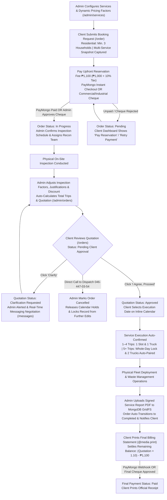

# Cleaneco Service Flow & System Operation Manual

This document details the complete, end-to-end service lifecycle and operational architecture of the **Cleaneco Waste Management Services** web platform, reflecting all current client and administrative workflows, dynamic pricing formulas, business rules, calendar capacity locks, fleet policies, security controls, and payment pathways.

---

## High-Level Operational Architecture

---

## System State & Lifecycle Reference

Every booking is tracked across four orthogonal state dimensions in MongoDB (`Order` schema):

| State Field | Allowed Values | Lifecycle Purpose |
| :--- | :--- | :--- |
| **`status`** | `Pending` → `In Progress` → `Completed` / `Cancelled` | Master operational state. Starts `Pending` until the `₱1,100` reservation payment clears (PayMongo webhook or Admin cheque approval), transitions to `Completed` automatically upon Service Report upload, or `Cancelled` exclusively by Admin action. |
| **`quotation_status`** | `Pending Inspection` → `Pending Client Approval` → `Clarification Requested` / `Approved` / `Client Declined` | Governs post-inspection pricing negotiation and unlocks service execution scheduling once `Approved`. Automatically set to `Client Declined` if the order is `Cancelled`. |
| **`cheque_status`** | `pending_verification` → `approved` / `rejected` | Tracks manual administrative verification for Commercial and Industrial cheque submissions (both reservation and final balance). |
| **`final_payment_status`** | `Pending` → `Paid` | Tracks settlement of the post-completion remaining balance without overwriting `status: 'Completed'`. |
| **`request_type`** | `null` / `Reschedule Requested` / `Cancel Requested` | Flags active client schedule-change requests (`reschedule_target`: `'inspection'` or `'execution'`) awaiting Admin approval or rejection. |

---

## Detailed Step-by-Step Service Lifecycle

### Phase 1: Service Configuration, Booking & Inspection Scheduling

#### 1. Dynamic Service & Pricing Configuration (Admin — `/admin/services`)
Before clients book, administrators configure the service catalog and pricing formulas in **Service Management** (`ServiceManagement.jsx`):
- **Pricing Parameters**: Each service defines a **Base Rate (`₱`)** and an optional flat **Fixed Fee (`₱`)** (e.g., mobilization or callout fee), alongside an operational status (`available` or `unavailable`).
- **Configurable Client Questionnaire Factors**:
  1. **Number Input (`number`)**: Multiplies the Base Rate directly (e.g., *Number of Septic Tanks / Grease Traps*), with configurable minimum and default values.
  2. **Dropdown Multiplier (`multiplier`)**: Multiplies the Base Rate by the selected option's factor (e.g., *Standard Tank `×1`*, *Large Tank `×2`*).
  3. **Dropdown Surcharge (`surcharge`)**: Appends a flat Peso add-on (`+₱`) to the service total (e.g., *Difficult Access `+₱1,500`*). Options can toggle **`requires_photo: true`**, prompting the client to upload a site photo (up to 5 MB, stored in MongoDB GridFS).
- **Trip-Counting Toggle (`counts_toward_trips`)**: Any factor can be flagged to multiply required vacuum truck trips for scheduling and fleet allocation.
- **Live Starting Price Preview & Input Sanitization**: Automatically previews the default starting price as factors are edited and slugifies field/option keys to prevent collisions.
- **Service Deletion Guard**: Backend validation (`/api/services/:id`) blocks deleting any service linked to historical or active orders, instructing administrators to toggle it **`Unavailable`** instead so order history remains intact.

#### 2. Service Selection, Group Rules & Booking Submission (Client — `/order`)
- **Account Classification & Residential 3-Household Minimum**:
  - **Residential Accounts (`residential`)**: Must register a **minimum of 3 participating households** (Resident Full Name + House/Lot/Street Address) under the **Residential Group Booking** block. Household #1 auto-syncs with the lead applicant, and additional households (`4+`) can be added dynamically—all covered by a single **`₱1,100`** group reservation fee.
  - **Commercial & Industrial Accounts (`commercial`, `industrial`)**: Bypass the 3-household requirement, store a registered `Company Name` (formatted system-wide as `Client Name (Company Name)`), and unlock Corporate Cheque payments.
- **Multi-Service Selection & Permanent Pricing Snapshot**:
  - Clients can select **multiple services** in a single transaction, filling out each service's dynamic questionnaire (`ServicePricingFields.jsx`), service region (`NCR` or `CALABARZON`), full address, optional nearest landmark, and additional notes.
  - All selected services share a unified `order_id` (`ORD...`), aggregated seamlessly across client cards and admin tables (`processGroupedOrders`).
  - At submission, the backend embeds an immutable **`pricing_snapshot`** inside the order document containing the exact rates, fixed fees, factor labels, multipliers, and surcharges active at booking time. Subsequent admin price edits never alter existing orders.
- **Estimated Base Cost & Trip Formulas** (`pricing.js`):

  $$\text{Service Estimate} = \left(\text{Base Rate} \times \prod \text{Number Inputs} \times \prod \text{Dropdown Multipliers}\right) + \sum \text{Surcharges} + \text{Fixed Fee}$$

  $$\text{Service Trips} = \begin{cases} \max\left(1, \lceil \prod \text{Trip-Counting Factors} \rceil\right) & \text{if any factor has } \text{counts\_toward\_trips} \\ 1 & \text{otherwise} \end{cases}$$
- **Interactive Inspection Calendar (`ClientCalendar.jsx`)**:
  - Enforces a **3-day minimum lead time** and a **30-day rolling booking window**.
  - Offers three daily windows: **`Morning (8AM - 12PM)`**, **`Afternoon (12PM - 5PM)`**, and **`Evening (5PM - 9PM)`**.
  - Automatically greys out admin-blocked **Unavailable Dates** (holidays/company events), slots already holding an active pending inspection (`1` pending inspection per slot), and entire days locked by a confirmed `5+` trip Whole-Day execution.

#### 3. Upfront Reservation Fee Payment (Client)
- **Fee Structure**: **`₱1,000.00`** Reservation & Inspection Fee + **`₱100.00`** (10% Service Tax) = **`₱1,100.00`** non-refundable deposit, credited in full toward the final bill.
- **Payment Pathways**:
  1. **PayMongo Online Checkout**: Supports Credit/Debit Cards, GCash, Maya, and GrabPay. Verified via HMAC-SHA256 webhook (`/api/payments/webhook`), automatically transitioning `status` from `Pending` → **`In Progress`**, updating revenue KPIs, and dispatching an EmailJS confirmation receipt. If a client exits checkout early, the order stays `Pending` on `/orders` with a 1-click **`Pay ₱1100.00 Reservation`** recovery card (hiding the progress bar until paid).
  2. **Corporate Cheque (Commercial & Industrial Only)**: Captures Bank Name, Cheque Number, and Account Name alongside a cheque photo streamed directly to **MongoDB GridFS** (`order_files`). Sets `cheque_status: 'pending_verification'` while `status` remains `Pending` until reviewed by staff.

#### 4. Cheque Verification & Inspection Confirmation (Admin — `/admin/orders`)
- **Action**: Opening the **Manage Order** side drawer in `OrderDatabase.jsx`:
  - **Details Tab**: Reviews client notes, participating households, and—for cheque bookings—inspects the GridFS cheque image and clicks **Approve** (transitions `status` to **`In Progress`** and notifies client) or **Reject** (notifies client and unlocks a **`Retry Payment`** button on `/orders`).
  - **Scheduling Tab**: Confirms or adjusts the **Confirmed Inspection Date** and **Confirmed Inspection Time Slot**, and assigns the initial reconnaissance **Truck Team**, advancing the client's visual tracker to **`For Inspection` (25%)**.

---

### Phase 2: Site Inspection, Dynamic Quotation & Client Negotiation

#### 5. Physical Site Inspection & Technical Assessment
- The reconnaissance crew inspects actual tank volume, hardened sludge/grease accumulation, pipeline obstructions, and hose-run distances on-site.

#### 6. Snapshot-Driven Quotation Generation & High-Capacity Rule (Admin — `/admin/orders`)
- **Action**: In the **Quotation** tab of the Manage Order drawer:
  - **Dynamic Factor Adjustment**: Renders each booked service from its `pricing_snapshot` via `ServicePricingFields.jsx`. The administrator updates factor quantities, multipliers, or surcharges to match actual on-site findings.
  - **Technical Justifications**: Enters per-factor operational notes (`justifications`) explaining any variance (e.g., *“Additional tank chamber discovered”* or *“Requires 50m extension hose”*).
  - **Capacity & High-Capacity Enforcement (Rule 1)**:
    - Automatically recomputes **Estimated Total Trips** across all services in the grouped order.
    - Orders requiring **`< 5` Trips** display a **`Single Slot (1 Truck)`** badge.
    - Orders requiring **`≥ 5` Trips** are automatically flagged with a **`Whole-Day Lock (2 Trucks)`** badge.
  - **Discount & Pricing Computation**:

    $$\text{Assessment Subtotal } (\text{price}) = \sum \text{Adjusted Service Estimates}$$

    $$\text{Final Quotation Total } (\text{final\_price}) = \max(0,\; \text{Assessment Subtotal} - \text{Discount Applied})$$
  - Clicking **Send Quotation to Client** sets `has_final_price: true` and `quotation_status: 'Pending Client Approval'`, advancing the client progress tracker to **`Quoted` (50%)** and sending an instant notification.

#### 7. Quotation Review, Clarification & Schedule Selection (Client — `/orders`)
- On **My Ongoing Orders**, the client inspects the itemized service configurations, admin justification notes, discount, 10% tax computation, and `₱1,100` reservation credit:
  1. **Path A — Approve & Schedule Execution (`I Agree, Proceed`)**:
     - Sets `quotation_status` to **`Approved`** and unlocks the printable **Final Billing Report**.
     - Immediately reveals the inline **Schedule Service Execution** calendar (`ClientCalendar` in `execution` mode) inside the order card.
     - For standard orders (`< 5` trips), the client picks an open date and time slot (`Morning`, `Afternoon`, or `Evening`). For high-capacity orders (`≥ 5` trips), clicking an open date automatically selects **`Whole Day`**.
     - Clicking **Confirm Schedule** validates live truck capacity and auto-confirms `service_execution_date` and `service_execution_time_slot`, advancing the tracker to **`For Service Execution` (75%)**.
  2. **Path B — Request Clarification (`Clarify` — Rule 3)**:
     - Sets `quotation_status` to **`Clarification Requested`** and dispatches a high-priority notification to administrators.
     - Using **Message Support** (`/client/messages?orderId=...`) or the floating **`ClientChatWidget`**, the client negotiates scope or pricing directly with administration in a conversation thread linked to the `order_id`. Admins can then revise factors or discounts and re-send the updated quotation.
  3. **Path C — Direct-Dispatch Cancellation Governance**:
     - Self-service decline/cancel buttons are intentionally omitted to protect fleet reservations. Clients are directed to call dispatch at **`046-447-03-54`**.
     - Only administrators can transition an order to **`Cancelled`** (protected by a confirmation dialog), which sets `quotation_status: 'Client Declined'`, immediately releases inspection/execution calendar holds, excludes the order from revenue KPIs, and permanently locks the cancelled record from further edits.

---

### Phase 3: Fleet Allocation, Capacity Locks & Reschedule Governance

#### 8. Fleet Availability & 2-Truck Auto-Pairing Engine (Rule 2)
- **Fleet Operational Toggles (`/admin/settings`)**: Administrators add/remove truck teams and toggle each unit between **`Available`** and **`Unavailable (Maintenance)`**.
- **Dynamic Slot Capacity (`/api/orders/availability`)**:
  - **Standard Executions (`< 5` Trips)**: Require at least `1` operational truck. Each booking consumes `1` truck in its chosen time slot; a slot locks only when booked executions equal the total count of operational trucks.
  - **High-Capacity Executions (`≥ 5` Trips)**: Require at least `2` operational trucks and an **entirely empty execution day**, applying a **Full-Day Lock** that blocks all other inspections and executions on that date.
- **2-Truck Auto-Pairing (`/admin/orders` → Scheduling Tab)**:
  - Once a `5+` trip quotation is `Approved`, the Scheduling tab switches from a single-team dropdown to a multi-truck checklist.
  - When `2` or more operational trucks exist, the system **automatically pre-pairs** the operational trucks (e.g., *“Truck Team 1 & Truck Team 2”*) and provides a 1-click **Auto-Select** helper. Save-time validation enforces that **exactly 2 operational trucks** are assigned.

#### 9. Conditional Two-Phase Reschedule Architecture
- **Lifecycle-Aware Controls**:
  - **`Reschedule Inspection`**: Visible strictly *before* a final quotation is issued (`!has_final_price`).
  - **`Reschedule Service Date`**: Visible strictly *after* `service_execution_date` is scheduled and before order completion/cancellation.
- **24-Hour Advance Guard & Admin Review**:
  - Backend validation rejects reschedule submissions made less than **24 hours** before the active appointment and re-verifies target slot/truck availability.
  - Administrators review the requested date, slot, and client reason in the **Details** tab of `/admin/orders`, clicking **Approve** (updates the target schedule and emails confirmation) or **Reject** (opens a custom reason modal and dispatches a formal explanation email and notification).

---

### Phase 4: Physical Operations & Quality Assurance

#### 10. Fleet Mobilization, Execution & Environmental Handling
- Assigned truck teams deploy on the confirmed execution schedule to perform septic siphoning/desludging, deep cleaning, or high-pressure declogging in accordance with DENR, DOH, and LGU sanitation protocols, obtaining physical client sign-off on the post-operation Service Report.

---

### Phase 5: Completion, Printable Billing, Final Settlement & Closure

#### 11. Service Report Upload & Automatic Completion (Admin — Rule 4)
- In the **Documents** tab of `OrderDatabase.jsx`, the administrator uploads the signed PDF **Service Report / Invoice** (`/api/orders/:id/upload-documents`).
- **Automated State Transition**: Streaming the Service Report into MongoDB GridFS (`order_files`) **automatically transitions `status` to `Completed`** (100% on the client progress tracker), dispatches a branded Completion Email via EmailJS, and sends an in-app notification.
- Redundant administrative quotation PDF uploads are deprecated; billing statements are generated dynamically on the client side from verified order data.

#### 12. Printable Final Billing Report & Final Balance Settlement (Client — `/orders`)
- **Browser-Native Printable Final Billing Report (`BillingTemplate.jsx`)**:
  - Unlocked as soon as `quotation_status === 'Approved'` or `status === 'Completed'`.
  - Uses zero-dependency CSS `@media print` (`window.print()`) with official company letterhead to render all snapshot factor values, admin justification notes, discounts, 10% Service Tax, and reservation fee deduction.
- **Final Balance Formula**:

  $$\text{Service Tax } (10\%) = \text{Final Quotation Total} \times 0.10$$

  $$\text{Remaining Balance Payable} = \max\Big(0,\; (\text{Final Quotation Total} \times 1.10) - \text{₱}1{,}100\Big)$$
- **Settlement & Official Receipt (`ReceiptTemplate.jsx`)**:
  - Once `status === 'Completed'`, the client clicks **`Pay Final Amount`**:
    - **PayMongo (`/api/payments/checkout-final`)**: Uses an `{order_id}_FINAL` reference tag; webhook confirmation sets `final_payment_status: 'Paid'`.
    - **Corporate Cheque (`/api/orders/:id/pay-cheque-final`)**: Commercial/Industrial clients upload final cheque proof to GridFS; Admin approval sets `final_payment_status: 'Paid'`.
  - Clients can print or save their formal **Official Receipt** (`ReceiptTemplate.jsx` via `window.print()`, complete with Operation Head sign-off) at any time once completed.

---

### Phase 6: Executive Analytics, Site Settings & PDF Reporting

#### 13. Executive Dashboard & 3-Tier PDF Export Suite
- **Admin Dashboard (`/admin` — `AdminLanding.jsx`)**:
  - Displays real-time **Total Revenue** (`₱1,100` reservation fees on active/completed orders + settled final balances), **Total Orders**, and **Completed Orders**.
  - Renders three interactive **Chart.js** visualizations: *Visit & Sales Statistics* (daily revenue bar chart), *Order Status Overview* (doughnut chart), and *Revenue Growth Statistics* (line chart toggleable across `Monthly`, `Quarterly`, and `Yearly` buckets), alongside the master **`AdminCalendar`** and *Recent Orders* feed.
- **Administrative PDF Reports**:
  1. **Operations & Sales Reports (`/admin`)**: Backend `pdfkit` engine (`/api/reports/generate?period=monthly|quarterly|yearly`) generating branded management summaries.
  2. **Order Database Report (`/admin/orders`)**: Frontend `jsPDF` + `jspdf-autotable` export respecting active service, status, and date filters.
  3. **Registered Users Report (`/admin/users`)**: Frontend `jsPDF` + `jspdf-autotable` directory export with formatted corporate names and roles.
- **Global Site Settings (`/admin/settings` — `AdminSettings.jsx`)**:
  - Live **Terms and Conditions PDF** upload (stored in MongoDB and served inline during registration and via header links), **Truck Teams** fleet manager, and **Unavailable Dates** blackout manager.

---

### Phase 7: Identity, Security & Account Lifecycle Governance

#### 14. Registration, Validation & Email Verification (`/register`)
- Enforces **18+ age validation**, strict Philippine mobile auto-formatting (`(+63) xxx-xxx-xxxx`), decomposed address inputs (Line 1, Line 2, Barangay, City, Province), account type (`residential`, `commercial`, `industrial` + `companyName`), password visibility toggles, and mandatory acceptance of the inline **Terms and Conditions PDF (`<iframe>`)**.
- Dispatches a 256-bit verification token via **EmailJS** over HTTPS (`/verify?token=...`), with an inline **Resend Verification Email** action on `/login` for unverified accounts.

#### 15. API Hardening, Brute-Force Lockout & Cross-Domain Sessions
- **API Protection**: Secured with `helmet` HTTP headers, a strict CORS origin whitelist, global IP rate limiting (100 requests / 15 minutes), and route-isolated raw-body HMAC verification on `/api/payments/webhook`.
- **Login Cooldown**: 5 consecutive failed login attempts trigger a 60-second IP lockout (`HTTP 429`) rendered as a live countdown timer on `Login.jsx`.
- **Dual-Storage Session Resilience**: Synchronizes auth state across `sessionStorage` and `localStorage` so cross-domain redirects to and from PayMongo never drop active user sessions.

#### 16. Cryptographic Forgot & Reset Password Flow (`/reset-password`)
- Users submit their username in the Forgot Password modal (`/api/auth/forgot-password`); regex-escaped lookup prevents ReDoS attacks and returns a privacy-masked email confirmation (e.g., `mo*****@g***.com`).
- Generates a 256-bit token (`crypto.randomBytes(32)`), stores only its **SHA-256 hash** in `User.resetPasswordToken` with a sparse index and 1-hour expiry (`resetPasswordExpires`), and emails the reset link via EmailJS.
- Submitting a new password hashes it with `bcryptjs` (10 rounds), clears reset tokens, resets `loginAttempts: 0` and lockouts, and logs an in-app security notification.

#### 17. 1-Year Inactivity Lock & User Administration (`/admin/users`)
- Accounts whose `last_login` exceeds **365 days** are automatically flagged `inactive: true` upon login attempt and prompted to contact administration.
- In **Registered Users** (`AdminUsers.jsx`), administrators can inline-edit user contact details, **Reactivate** inactive accounts in one click, and delete non-admin accounts (admin accounts are protected from deletion). Client contact updates automatically notify administrators.

---

### Phase 8: Real-Time Communications, Public Support & Accreditations

#### 18. Real-Time Messaging Hub & Deep-Linked Notifications
- **Omnichannel Chat**: Authenticated clients can message support from any page via the floating **`ClientChatWidget`** (3.5s active polling / 15s background badge polling) or the full-page hub (`/messages`, `/client/messages`). Administrators manage all threads at `/admin/messages` with search by name, email, username, company, or `order_id`.
- **Smart Notification Routing (`notificationRoutes.js`)**: Clicking any notification in the client or admin bell tray marks it read and deep-links straight to the target view—auto-scrolling and highlighting the specific order card on `/orders?orderId=...`, auto-opening the Manage Order drawer on `/admin/orders?orderId=...`, or opening the linked chat thread.

#### 19. Public Contact & Complaints System (`/contact`)
- Accessible to both guests (`/contact`) and logged-in clients (`/client/contact`), supporting categorized submissions (`Inquiry`, `Complaint`, `Feedback`, `Follow-up`) routed directly to management via EmailJS in alignment with ISO/IEC 25010 quality standards.

#### 20. Government Compliance & Searchable Resource Hub (`/resources`)
- Showcases Cleaneco's four regulatory pillars in a responsive 4-column compliance grid alongside an interactive keyword-routed FAQ search bar:
  - **DENR**: National environmental compliance for sewage, septage, and hazardous waste collection, treatment, and disposal.
  - **DOH**: Strict public health and sanitation adherence for human waste handling.
  - **LGU**: Full operational licensing and accreditation across local government jurisdictions.
  - **PCAPI R4A**: Active affiliation with the **Pollution Control Association of the Philippines Region IV-A Chapter**, ensuring continuous DENR-EMB accredited training for Pollution Control Officers (PCOs).

---

## Role & Permission Matrix

| Feature / Action | Guest | Client | Administrator |
| :--- | :---: | :---: | :---: |
| Browse Services, Accreditations (`/resources`) & Submit Contact/Complaints (`/contact`) | ✅ | ✅ | ✅ |
| Register Account (18+, Inline TOS PDF) & Verify Email | ✅ | — | — |
| Initiate Cryptographic Forgot & Reset Password Flow | ✅ | ✅ | ✅ |
| Configure Services, Dynamic Pricing Factors & Availability (`/admin/services`) | ❌ | ❌ | ✅ |
| Submit Multi-Service Booking (Residential 3-Household Group / Corporate) | ❌ | ✅ | ✅ (`/admin/order-form`) |
| Pay `₱1,100` Reservation Fee (PayMongo Online / Commercial & Industrial Cheque) | ❌ | ✅ | ❌ |
| Verify / Approve or Reject Corporate Cheque Submissions (GridFS Proof) | ❌ | ❌ | ✅ |
| Confirm Site Inspection Schedule & Assign Recon Team | ❌ | View only | ✅ |
| Request Inspection or Service Execution Reschedule (≥24h Advance Rule) | ❌ | ✅ | Approve / Reject with Reason |
| Adjust Post-Inspection Pricing Factors, Justifications & Discounts | ❌ | View only | ✅ |
| Enforce & Auto-Pair 2 Operational Trucks for High-Capacity Jobs (`≥5` Trips) | ❌ | Automatic Whole-Day Calendar | Mandatory 2-Truck Selection |
| Manage Fleet Operational Status & Block Unavailable Dates (`/admin/settings`) | ❌ | ❌ | ✅ |
| Upload Live Terms & Conditions PDF (`/admin/settings`) | ❌ | View PDF | ✅ |
| Approve Quotation & Auto-Confirm Service Execution Schedule | ❌ | ✅ | View Schedule |
| Request Quotation Clarification & Negotiate in Real-Time Messaging Hub | ❌ | ✅ | ✅ |
| Cancel Order & Release Calendar Holds | ❌ | Direct Call to Dispatch | ✅ (Locks Order from Edits) |
| Upload Signed Post-Service Report PDF (Auto-Completes Order) | ❌ | View / Download PDF | ✅ |
| Print Itemized Final Billing Statement (`@media print`) | ❌ | ✅ | ❌ |
| Settle Remaining Final Balance & Print Official Receipt (`@media print`) | ❌ | ✅ | View Payment Status |
| Manage Users, Reactivate 1-Year Inactive Accounts & Export PDF Reports | ❌ | ❌ | ✅ |
