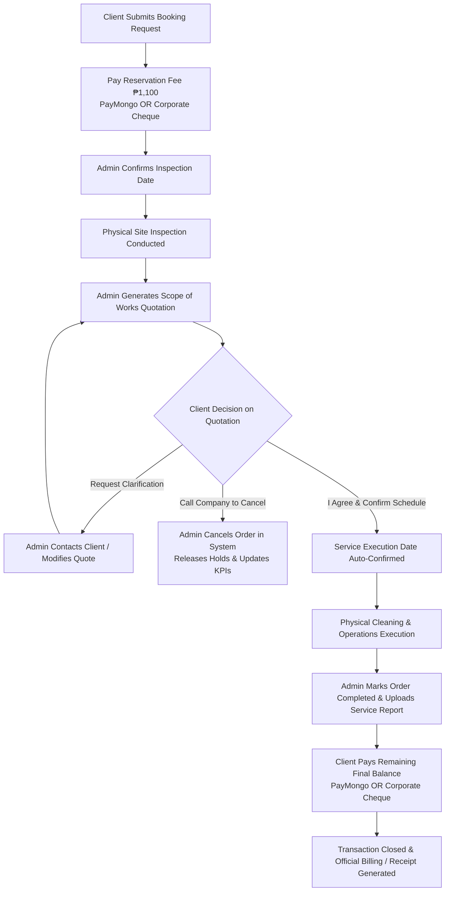

# Cleaneco Service Flow & System Operation Manual

This document details the complete, end-to-end service lifecycle of the Cleaneco web application, reflecting all current workflows, business rules, administrative controls, and payment methods implemented across Phase 1 and Phase 2.

---

## High-Level Operational Architecture

---

## Detailed Step-by-Step Service Lifecycle

### Phase 1: Booking & Inspection Scheduling

#### 1. Service Selection & Booking Request (Client)
- **Action**: Client navigates to `/order` and selects a service (e.g., *Septic Tank Cleaning*, *Sewage Treatment Plant Maintenance*, *Grease Trap Cleaning*).
- **Form Inputs**:
  - Account Type: `Residential`, `Commercial`, or `Industrial` (Commercial/Industrial accounts specify Company Name).
  - Site Accessibility: `Easy`, `Moderate`, or `Challenging` with optional site photo upload.
  - Estimation parameters (number of tanks, capacity, sludge levels).
  - Preferred **Site Inspection Date & Time Slot** (Morning, Afternoon, Evening) chosen from the live interactive calendar.
  - Unavailable dates or locked holidays set by admins are automatically disabled.

#### 2. Reservation Fee Payment (Client)
- **Requirement**: A standard non-refundable reservation fee of **₱1,100** secures the inspection slot.
- **Payment Pathways**:
  - **Online Payment (PayMongo)**: Residential & corporate clients can pay immediately via GCash, Maya, GrabPay, or Credit/Debit Cards.
  - **Corporate Cheque**: Available exclusively to Commercial and Industrial clients. Requires bank details (Issuing Bank, Cheque Number, Account Name, Cheque Date) and proof of cheque image upload (stored directly in MongoDB GridFS).
- **Outcome**:
  - PayMongo orders update immediately to `Payment Status: Paid`.
  - Cheque orders set `Payment Status: Pending Cheque Verification` and notify admin staff.

#### 3. Administrative Inspection Confirmation (Admin)
- **Action**: In `OrderDatabase.jsx`, the administrator reviews the new order:
  - Verifies submitted details and validates cheque image (if paid by cheque).
  - Confirms the **Inspection Schedule** and optionally assigns a reconnaissance staff member or truck team.
  - Client dashboard reflects: *“Confirmed Inspection Schedule: [Date] ([Slot])”*.

---

### Phase 2: Site Inspection & Hierarchical Quotation

#### 4. Physical Site Inspection & Technical Assessment
- The operations team visits the physical location to assess actual tank conditions, sludge depth, access challenges, and required vacuum equipment.

#### 5. Quotation Generation with Scope of Works (Admin)
- **Action**: In the Admin Order Drawer, the admin opens **Manage Quotation**:
  - Constructs a granular **Hierarchical Scope of Works**:
    - **Main Scope Item**: e.g., *“Septic Tank Siphoning & Sludge Hauling”*.
    - **Sub-Items & Specifications**: Parameters such as *Capacity (m³)*, *Number of Trips*, *Enzyme Treatment Additives*.
    - **Technical Justification**: Mandatory notes explaining to the client why each line item exists (e.g., *“Heavy sediment accumulation requires double trip capacity”*).
    - **Item Unit Price**: Individual item costing.
  - Sets **Global Discount** (if applicable).
  - The system automatically calculates:
    $$\text{Final Price} = \text{Sum of Subtotals} - \text{Discount}$$
    $$\text{Remaining Balance Due} = \text{Final Price} - ₱1,100 \text{ (Reservation Fee)}$$
  - Admin changes status to **`Pending Client Approval`**, making the formal quote visible to the customer.

#### 6. Quotation Review & Decision (Client)
- The customer visits `/ongoing-orders` to view the comprehensive breakdown:
  - **Visible Deduction**: The ₱1,100 reservation fee is anchored in green as an already-paid deduction.
  - **Decision Options**:
    1. **Path A — “I Agree” (Proceed)**:
       - Displays a scheduling calendar directly in the modal for the client to choose their **Service Execution Date & Time Slot**.
       - Once submitted, shows a green checkmark confirmation. The service date is locked into the schedule.
    2. **Path B — “Request Clarification”**:
       - The client submits a question or negotiation note.
       - Quotation status switches to `Clarification Requested`.
       - Admin contacts the client by phone to explain technical specifications or adjusts line items.
    3. **Path C — Customer Cancellation Policy (Direct Contact)**:
       - Rather than an arbitrary "Decline" button, the dashboard features a notice instructing clients that cancellations must be coordinated directly with company dispatch at **`046-447-03-54`**.
       - **Admin Authority**: Only company administrators can formally mark an order as `Cancelled (Client Declined)`. This releases calendar holds and updates cancelled order KPIs automatically.

---

### Phase 3: Service Scheduling & Reschedule Workflows

#### 7. Service Date Auto-Confirmation
- Upon agreement, the selected Service Execution date and time slot are saved.
- Client dashboard displays:
  > *“Your service is auto-confirmed for [Execution Date] at [Time Slot].”*

#### 8. Conditional Rescheduling Architecture (Approach A)
- To prevent operational confusion, reschedule buttons appear strictly according to the order's active phase:
  - **Reschedule Inspection Button**:
    - Only visible **before** the quotation has a final price.
    - Hidden once site inspection is complete and pricing is issued.
  - **Reschedule Service Date Button**:
    - Only visible **after** service execution is scheduled and order is active (not Completed or Cancelled).
    - Styled with Cleaneco Brand Green (`#0D8D1E`) and white hover fill (`.btn-outline-cleaneco`).
- **Reschedule Policy**:
  - Must be requested at least 24 hours in advance.
  - Submits proposed new date, time slot, and reason.
  - **Admin Approval**: Admin reviews the proposed schedule in the database and clicks **Approve** or **Reject** (with required reason shown to client), ensuring full fleet control.

---

### Phase 4: Physical Operations Execution

#### 9. Mobilization, Cleaning & Post-Op
- Cleaneco operations team dispatches trucks and vacuum equipment.
- In `OrderDatabase.jsx`, administrators track execution:
  - Assign specific truck crews (e.g., *“Team Charlie - Isuzu Elf #4”*).
  - Keep internal notes on progress and waste transfer manifests.

---

### Phase 5: Billing, Final Payment & Order Closure

#### 10. Service Completion & Billing Generation
- When physical work concludes:
  - Admin marks the order status as **`Completed`**.
  - Admin uploads the signed physical Service Report / Manifest.
  - System automatically unlocks the **Final Payment** action on the client dashboard.
  - System enables the **Print Billing Statement** button (`BillingTemplate.jsx`), allowing clients and accounting teams to print official itemized invoices with `@media print` formatting.

#### 11. Final Balance Settlement
- The customer settles the remaining balance ($\text{Final Price} - ₱1,100$):
  - **PayMongo**: Seamless checkout using Cards, GCash, Maya.
  - **Corporate Cheque**: Commercial/Industrial clients submit final cheque details and proof photo for admin verification.
- Upon approval/completion:
  - Order status updates to **`Paid`**.
  - The client can print the formal **Official Receipt** (`ReceiptTemplate.jsx`) at any time.

---

## Role & Permission Matrix

| Feature / Action | Client | Administrator |
| :--- | :---: | :---: |
| Submit Initial Booking | ✅ | ❌ |
| Pay ₱1,100 Reservation (PayMongo / Cheque) | ✅ | ❌ |
| Confirm / Reschedule Inspection Date | Request only | Full Control / Approval |
| Build Hierarchical Scope of Works | View only | Create & Edit |
| Approve Quotation & Select Execution Date | ✅ | View only |
| Request Reschedule (24h in advance) | Submit Request | Approve / Reject |
| Cancel Order | Direct Call to Dispatch | Execute & Free Holds |
| Assign Truck Teams & Fleet | ❌ | ✅ |
| Verify Corporate Cheques | ❌ | ✅ |
| Generate Printable Invoices & Billing Statements | ✅ | ✅ |
| Export System PDF Reports with Official Header | ❌ | ✅ |
