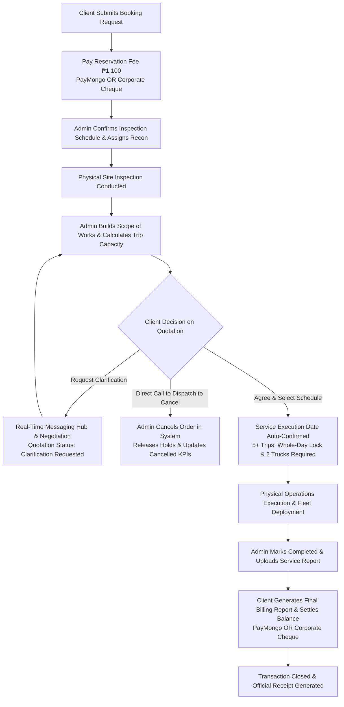

# Cleaneco Service Flow & System Operation Manual

This document details the complete, end-to-end service lifecycle of the Cleaneco web application, reflecting all current workflows, business rules, administrative controls, security architectures, fleet management policies, and payment pathways.

---

## High-Level Operational Architecture

---

## Detailed Step-by-Step Service Lifecycle

### Phase 1: Booking & Inspection Scheduling

#### 1. Service Selection & Booking Request (Client)
- **Action**: Client navigates to `/order` and selects one or more services.
- **Dynamic Pricing & Form Factors**:
  - Each service dynamically loads its client questionnaire and formula factors configured by administrators in Service Management (`/services`).
  - **Factor Types**: Number multipliers (e.g. Number of Tanks / Units), Dropdown Multipliers (e.g. Tank Capacity / Size), and Dropdown Surcharges (e.g. Difficult Site Accessibility with optional site photo upload).
  - **Permanent Pricing Snapshot**: When an order is created, the system captures an immutable `pricing_snapshot` of the exact rates, factors, and surcharges in effect at that moment. Future rate updates by administrators will never alter previously booked orders.
- **Form Inputs**:
  - **Account Classification**: `Residential`, `Commercial`, or `Industrial` (Commercial & Industrial accounts require registered Company Name).
  - **Dynamic Service Fields**: Configured factors for each selected service.
  - **Preferred Inspection Schedule**: Date & time slot (Morning, Afternoon, Evening) chosen from the interactive calendar. Locked holidays and admin-blackout dates are automatically disabled.

#### 2. Reservation Fee Payment (Client)
- **Requirement**: A standard non-refundable reservation fee of **₱1,100** secures the inspection slot.
- **Payment Pathways**:
  - **Online Gateway (PayMongo)**: Residential & commercial clients pay instantly via GCash, Maya, GrabPay, or Credit/Debit Cards.
  - **Corporate Cheque**: Available exclusively to Commercial and Industrial clients. Requires bank details (Issuing Bank, Cheque Number, Account Name, Cheque Date) and proof image upload streamed directly to **MongoDB GridFS** for cloud persistence.
- **Outcome**:
  - PayMongo orders update immediately to `Payment Status: Paid`.
  - Cheque orders set `Payment Status: Pending Cheque Verification` and alert administrators in the Order Database.

#### 3. Administrative Inspection Confirmation (Admin)
- **Action**: In `OrderDatabase.jsx`, the administrator reviews the new order:
  - Validates submitted parameters and verifies cheque authenticity (if applicable).
  - Confirms the **Confirmed Inspection Date** and **Time Slot**.
  - **Centralized State Pipeline**: Order updates run through `processGroupedOrders`, ensuring all service parameters and `service_ids` remain fully populated in memory without requiring manual browser reloads.
  - Client dashboard reflects: *“Confirmed Inspection Schedule: [Date] ([Time Slot])”*.

---

### Phase 2: Site Inspection, Capacity Calculation & Quotation

#### 4. Physical Site Inspection & Technical Assessment
- The operations team visits the physical location to assess actual tank volume, sludge density, hose run distances, and structural accessibility.

#### 5. Quotation Generation & High-Capacity Enforcement (Admin)
- **Action**: In the Admin Order Drawer (`OrderDatabase.jsx`), the admin opens the **Quotation** tab:
  - **Hierarchical Scope of Works**:
    - **Main Scope Deliverable**: e.g., *“Septic Tank Siphoning & Sludge Extraction”*.
    - **Capacity & Trip Calculator**: Computes required trips based on septic tank dimensions ($1\text{ trip} \approx 4\text{ to }5\text{ m}^3$).
    - **High-Capacity Rule (Rule 1)**: Orders requiring **5 or more trips** are automatically flagged as **Whole-Day Lock orders** requiring deployment of **2 operational vacuum trucks**.
    - **Granular Line Items & Justifications**: Mandatory operational notes explaining why each charge exists (e.g., *“Heavy solidified grease caps require motorized auger declogging”*).
    - **Unit Costing & Discounts**: Global discount deductions with automatic subtotal calculation.
  - The system automatically calculates:
    $$\text{Subtotal} = \sum \text{Scope Items} - \text{Discount}$$
    $$\text{Final Balance Due} = \text{Subtotal} - ₱1,100 \text{ (Reservation Deduction)}$$
  - Status updates to **`Pending Client Approval`**, releasing the formal interactive quotation to the client.

#### 6. Quotation Review & Interactive Decisions (Client)
- The customer visits `/orders` to review the quotation:
  - **Transparent Accounting**: The ₱1,100 reservation fee is anchored in green as an already-deducted deposit.
  - **Decision Options**:
    1. **Path A — Agree & Confirm Schedule**:
       - Displays the execution calendar directly within the modal.
       - Client selects preferred **Service Execution Date & Time Slot**.
       - Locks the booking into the master fleet schedule with a confirmation modal.
    2. **Path B — Request Clarification (Rule 3)**:
       - The client submits a clarification note regarding scope or pricing.
       - Quotation status switches to **`Clarification Requested`**.
       - Triggers an automated notification and initiates a dedicated inquiry thread in the **Real-Time Client/Admin Messaging Hub** (`/messages`).
       - Admin can reply directly via chat or adjust quotation items.
    3. **Path C — Cancellation Policy (Direct Dispatch)**:
       - Self-service quotation decline buttons are intentionally omitted to prevent accidental cancellations. Clients must contact dispatch directly at **`046-447-03-54`**.
       - Only administrators hold the authority to cancel an order, which immediately frees calendar holds and updates cancelled order metrics.

---

### Phase 3: Fleet Management & Service Scheduling

#### 7. Fleet Allocation & 2-Truck Auto-Pairing (Rule 2)
- **Fleet Availability Toggles**: Administrators manage truck operational statuses in **Admin Settings** (`available` vs. `unavailable - maintenance`).
- **Standard Orders (<5 Trips)**: Requires assignment of 1 operational vacuum truck team.
- **High-Capacity Orders (≥5 Trips)**:
  - Enforces mandatory assignment of **exactly 2 operational trucks** for whole-day service execution.
  - **Auto-Pairing Engine**: If exactly 2 operational trucks are available in fleet settings, the system automatically pre-selects both trucks (e.g., *“Team Charlie & Team Alpha”*).
  - Validation guards prevent saving high-capacity execution dates until 2 valid, non-maintenance trucks are designated.

#### 8. Conditional Reschedule Architecture
- **Reschedule Inspection Button**: Strictly visible **before** quotation issuance. Hidden once on-site inspection is completed.
- **Reschedule Service Date Button**: Visible **after** service execution scheduling, adhering to primary brand tokens (`.btn-outline-cleaneco`).
- **24-Hour Policy & Admin Review**: Reschedule requests must be submitted at least 24 hours in advance with a stated reason. Administrators evaluate requests in `OrderDatabase.jsx` and either approve or reject with a formal explanation email.

---

### Phase 4: Physical Operations & Quality Assurance

#### 9. Mobilization, Cleaning & Waste Transfer
- Assigned truck crews deploy to the site with heavy-duty vacuum tankers and specialized hoses.
- Siphoning, sludge pumping, and high-pressure washing are executed in compliance with environmental standards.
- Operations teams log manifests and record completed tank volume.

---

### Phase 5: Billing, Final Settlement & Closure

#### 10. Service Completion & Client-Side Final Billing Report (Rule 4)
- Upon physical job completion:
  - Admin marks order status as **`Completed`** and uploads the signed physical Service Report / Manifest (`/orders/:id/upload-documents`).
  - **Elimination of Redundant PO Uploads**: Administrative quotation uploads are deprecated. Instead, clients auto-generate the official **Final Billing Report** on-demand via `BillingTemplate.jsx` and `jspdf`, including electronic client signature capture and itemized VAT computations.
  - The client dashboard unlocks the **Final Payment** button and **Print Billing Statement** action.

#### 11. Final Balance Settlement
- Customer settles remaining balance ($\text{Final Price} - ₱1,100$):
  - **PayMongo**: GCash, Maya, GrabPay, Credit/Debit Cards with automated webhook confirmation.
  - **Corporate Cheque**: Commercial/Industrial clients submit final cheque details and bank receipt images for admin verification.
- Order transitions to **`Paid`**.
- Client can download and print the formal **Official Receipt** (`ReceiptTemplate.jsx`) at any time.

---

### Phase 6: Identity, Security & Account Management

#### 12. Registration & Email Verification
- Users register with granular address fields, phone number formatting (`xxx-xxx-xxxx`), and Terms of Service acceptance.
- System sends an automated branded verification email via cloud **EmailJS** (`template_ns5zlcs`).
- Verification tokens are validated through `/verify?token=...` to activate the account.

#### 13. Brute-Force Rate Limiting & Account Lockout
- Authentication endpoints enforce strict IP-based rate limiting via `express-rate-limit`.
- 5 consecutive failed login attempts trigger a 60-second cooldown with an interactive live countdown timer.

#### 14. Automated Forgot & Reset Password Flow
- **Request Step**: User inputs username in the Login modal (`/api/auth/forgot-password`).
- **Cryptographic Security**: Generates a 256-bit cryptographic token (`crypto.randomBytes(32)`).
- **Hashed at Rest**: Stored as a **SHA-256 hash** in MongoDB `User.resetPasswordToken` with a sparse index and a strict 1-hour expiration timestamp (`resetPasswordExpires`).
- **Delivery**: Dispatches an email with a secure reset link (`/reset-password?token=...`).
- **Account Recovery**: Submitting a valid new password hashes the password via bcrypt (10 rounds), clears the reset token, resets `loginAttempts: 0`, unlocks any existing lockout, and writes an in-app audit notification.

---

### Phase 7: Real-Time Messaging Hub & Accreditation

#### 15. In-App Messaging & Notification Ecosystem
- **Client Chat Widget & Hub**: Clients can open the floating widget on any page or access full conversations at `/messages`.
- **Admin Communications**: Centralized message management at `/admin/messages` with unread indicators and real-time thread updates.
- **Interactive Toast Routing**: Notification toasts link directly to relevant orders, automatically opening the drawer to the correct active tab (`details`, `quotation`, `scheduling`, `documents`).

#### 16. Government Compliance & Accreditation
- **DENR**: Compliance with environmental standards for sewage, septage, and hazardous waste treatment under national laws.
- **DOH**: Adherence to public health and sanitation codes for human waste handling.
- **LGU**: Fully licensed and accredited across all operational local government units.
- **PCAPI R4A**: Affiliated with the **Pollution Control Association of the Philippines Region IV-A Chapter**, ensuring continuous accredited DENR-EMB training for Pollution Control Officers (PCOs) and proactive environmental stewardship.

---

## Role & Permission Matrix

| Feature / Action | Client | Administrator |
| :--- | :---: | :---: |
| Submit Initial Booking Request | ✅ | ❌ |
| Pay ₱1,100 Reservation Fee (PayMongo / Cheque) | ✅ | ❌ |
| Confirm / Adjust Site Inspection Date | Request only | Full Control / Approval |
| Build Hierarchical Scope of Works & Calculate Capacity | View only | Create & Edit |
| Enforce 2-Truck Assignment (5+ Trips) | Automatic Notice | Mandatory Selection |
| Manage Fleet Operational Status (Available/Maintenance) | ❌ | Full Control |
| Auto-Pair Available Trucks for High-Capacity Jobs | ❌ | Automated Assistance |
| Request Quotation Clarification | ✅ | Respond & Adjust |
| Cancel Order | Direct Call to Dispatch | Execute & Release Holds |
| Access Real-Time Messaging Hub | ✅ | ✅ |
| Initiate Forgot & Reset Password Flow | ✅ | ❌ |
| Verify Corporate Cheques | ❌ | ✅ |
| Auto-Generate Printable Final Billing Statement | ✅ | ✅ |
| Upload Signed Post-Service Report / Manifest | ❌ | ✅ |
| Settle Final Balance & Generate Official Receipt | ✅ | View & Confirm |
| Export Administrative Reports (PDF / Excel) | ❌ | ✅ |

